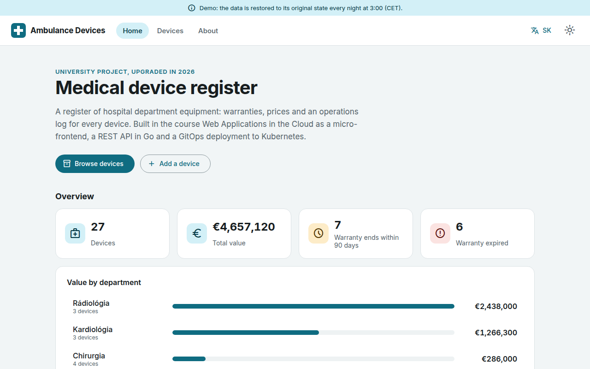
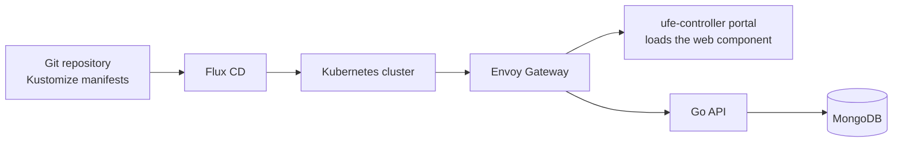

# Ambulance Devices

[](https://github.com/AkosKappel/wac/actions/workflows/ci.yml)

A register of medical devices in hospital departments: devices with warranty, price and department, each with its own operations log. Built in the course *Webové aplikácie v prostredí cloudu* (Web Applications in the Cloud, FIIT STU) as a micro-frontend, a REST API and a GitOps setup for Kubernetes. The UI is in Slovak and English.

**Live demo:** https://ambulance.tailb52c43.ts.net (the demo data is restored every night at 03:30 CET). API docs: [/api-docs/](https://ambulance.tailb52c43.ts.net/api-docs/).



## Features

- Homepage with an overview computed by one MongoDB aggregation (`/api/stats`): device count and value, warranty states, value per department, log entries per month, and devices due for service.
- Device list with search, filters by department and warranty state, sorting, filters kept in the URL, and CSV export.
- Device form, a change history of its fields, and an operations log with entry types (purchase, installation, service, calibration, repair), validated in the browser and in the API.
- Service plan: a service interval per device; a log entry of type service moves the next date, and `/api/maintenance/due` lists the devices due, computed in MongoDB.
- Departments with floor and head of department (full CRUD); devices refer to them by code, a new name reaches their devices, and a department with devices cannot be deleted.
- Warranty and service state at a glance: valid, due soon (amber), expired or overdue (red).
- A printable device label with a QR code to the device page.
- Installable as a PWA: pages already visited work offline.
- Slovak and English, light and dark theme, both remembered per browser.
- About page with the architecture and the stack.

## Architecture


The live demo runs on a home server with Docker Compose. In the course, the same parts ran on Kubernetes:



## Repository

| Folder | Contents |
| --- | --- |
| [`wac-ufe/`](wac-ufe/) | Micro-frontend: Stencil web components with Material Web, API client generated from the OpenAPI spec |
| [`wac-api/`](wac-api/) | REST API in Go (Gin) on MongoDB, server stubs generated from [`ambulance-wl.openapi.yaml`](wac-api/api/ambulance-wl.openapi.yaml) |
| [`wac-gitops/`](wac-gitops/) | Kubernetes manifests (Kustomize) deployed by Flux CD to the course's AKS cluster and to a local cluster, with Envoy Gateway and the ufe-controller that loads the micro-frontend into the shared portal |
| [`docker/`](docker/) | The single-host deployment used for the live demo |
| [`scripts/`](scripts/) | `generate-api.sh` regenerates the Go server stubs and the TypeScript client from the spec |

## Run locally

Needs Docker. Copy `.env.example` to `.env`, set `MONGO_ROOT_PASSWORD` and `AMBULANCE_API_MONGODB_PASSWORD` (the API connects as a user limited to its own database), then:

```bash
docker compose up -d --build
```

The app is served at http://127.0.0.1:8081. nginx serves the built frontend and proxies `/api` to the Go service; MongoDB starts with the demo data from [`docker/mongo/seed.js`](docker/mongo/seed.js) and is reachable at `127.0.0.1:27018` for tools such as Compass.

For frontend work, `npm start` in `wac-ufe/` serves the app at http://localhost:3333 against a mock API generated from the spec. To use the real API from that dev server instead, start the API with `AMBULANCE_API_CORS_ORIGINS=http://localhost:3333`.

## Tests and checks

```bash
cd wac-api && gofmt -l . && go vet ./... && go test ./...
```

The API tests include an integration test against a real MongoDB, which runs when the `AMBULANCE_API_MONGODB_*` variables point at one and is skipped otherwise.

```bash
cd wac-ufe && npm run lint && npm run test:spec
```

`npm test` runs the spec tests and the end-to-end tests in a headless Chrome, as CI does. On the home server run only the spec tests and single end-to-end files (`npm run test:e2e -- <file>`): the full suite overloads the machine and the live apps. The scripts pass `--max-workers=1` because Stencil ignores `testing.maxWorkers` and starts one worker per CPU otherwise. `npm run build` also type-checks.

After changing [`ambulance-wl.openapi.yaml`](wac-api/api/ambulance-wl.openapi.yaml), run `scripts/generate-api.sh` (needs Docker and Go) and commit the result.

[CI](.github/workflows/ci.yml) runs all of this on every push and pull request, against a MongoDB service container, plus `govulncheck`, `npm audit` and a check that the generated code matches the spec.

## Deployment

The live demo runs on a home server with Docker Compose instead of Kubernetes: nginx, the API, MongoDB and a small service that restores the demo data every night. CI builds the API and nginx images on every push to `main` and pushes them to GHCR (`ghcr.io/akoskappel/wac-api`, `wac-nginx`). Production runs those images from its own folder on the server, with a Tailscale sidecar publishing it over HTTPS with Funnel; see [`deploy/`](deploy/README.md). The compose file in the repository root is for development only. The Kubernetes setup in `wac-gitops/` is kept as it ran in the course.
