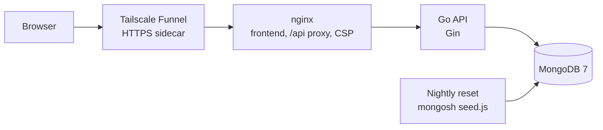
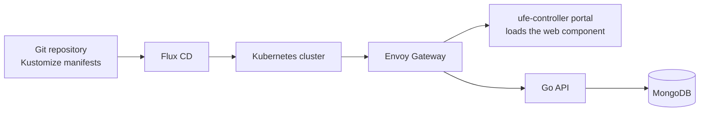

# Ambulance Devices

A register of medical devices in hospital departments: devices with warranty, price and department, each with its own operations log. Built in the course *Webové aplikácie v prostredí cloudu* (Web Applications in the Cloud, FIIT STU) as a micro-frontend, a REST API and a GitOps setup for Kubernetes, and upgraded in 2026. The UI is in Slovak and English.

**Live demo:** https://ambulance.tailb52c43.ts.net (the demo data is restored every night at 03:00 CET). API docs: [/api-docs/](https://ambulance.tailb52c43.ts.net/api-docs/).


## Features

- Homepage with an overview: device count, total value, warranties ending within 90 days or expired, value per department.
- Device list with search, filters by department and warranty state, sorting, filters kept in the URL, and CSV export.
- Device form and an operations log per device, validated in the browser and in the API.
- Warranty state at a glance: valid, ending within 90 days (amber), expired (red).
- Slovak and English, light and dark theme, both remembered per browser.
- About page with the architecture and the stack.

## Architecture



The live demo runs on a home server with Docker Compose. In the course, the same parts ran on Kubernetes:



## Repository

| Folder | Contents |
| --- | --- |
| [`wac-ufe/`](wac-ufe/) | Micro-frontend: Stencil web components with Material Web, API client generated from the OpenAPI spec |
| [`wac-api/`](wac-api/) | REST API in Go (Gin) on MongoDB, server stubs generated from [`ambulance-wl.openapi.yaml`](wac-api/api/ambulance-wl.openapi.yaml) |
| [`wac-gitops/`](wac-gitops/) | Kubernetes manifests (Kustomize) deployed by Flux CD to the course's AKS cluster and to a local cluster, with Envoy Gateway and the ufe-controller that loads the micro-frontend into the shared portal |
| [`docker/`](docker/) | The single-host deployment used for the live demo |

## Run locally

Needs Docker. Copy `.env.example` to `.env`, set `AMBULANCE_API_MONGODB_PASSWORD`, then:

```bash
docker compose up -d --build
```

The app is served at http://127.0.0.1:8084. nginx serves the built frontend and proxies `/api` to the Go service; MongoDB starts with the demo data from [`docker/mongo/seed.js`](docker/mongo/seed.js) and is reachable at `127.0.0.1:27019` for tools such as Compass.

For frontend work, `npm start` in `wac-ufe/` serves the app at http://localhost:3333 against a mock API generated from the spec. To use the real API from that dev server instead, start the API with `AMBULANCE_API_CORS_ORIGINS=http://localhost:3333`.

## Tests

```bash
cd wac-api && go test ./...
```

The API tests include an integration test against a real MongoDB, which runs when the `AMBULANCE_API_MONGODB_*` variables point at one and is skipped otherwise.

```bash
cd wac-ufe && npx stencil test --spec
```

`npm test` in `wac-ufe/` also runs the end-to-end tests in a headless Chrome.

## Deployment

The live demo runs on a home server with Docker Compose instead of Kubernetes: nginx, the API, MongoDB and a small service that restores the demo data every night. A Tailscale sidecar ([`docker-compose.tailscale.yml`](docker-compose.tailscale.yml)) publishes it over HTTPS with Funnel. The Kubernetes setup in `wac-gitops/` is kept as it ran in the course.
