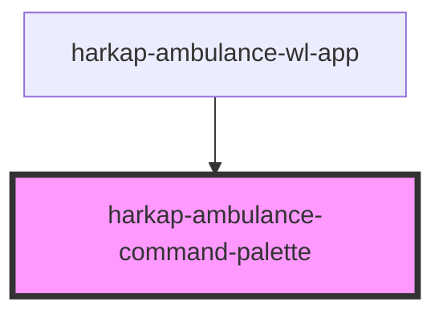

# harkap-ambulance-command-palette

<!-- Auto Generated Below -->

## Overview

Ctrl+K / Cmd+K jump list: type to filter the pages and actions, find devices and
departments by name or code, or search the device list for what was typed.

## Properties

| Property   | Attribute   | Description | Type     | Default     |
| ---------- | ----------- | ----------- | -------- | ----------- |
| `apiBase`  | `api-base`  |             | `string` | `undefined` |
| `basePath` | `base-path` |             | `string` | `''`        |

## Dependencies

### Used by

 - [harkap-ambulance-wl-app](../harkap-ambulance-wl-app)

### Graph

----------------------------------------------

*Built with [StencilJS](https://stenciljs.com/)*
