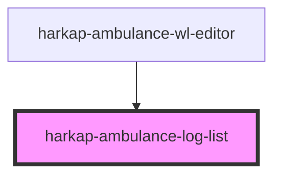

# harkap-ambulance-log-list

<!-- Auto Generated Below -->

## Properties

| Property   | Attribute   | Description | Type     | Default     |
| ---------- | ----------- | ----------- | -------- | ----------- |
| `apiBase`  | `api-base`  |             | `string` | `undefined` |
| `deviceId` | `device-id` |             | `string` | `undefined` |

## Events

| Event         | Description | Type                  |
| ------------- | ----------- | --------------------- |
| `log-clicked` |             | `CustomEvent<string>` |

## Dependencies

### Used by

 - [harkap-ambulance-wl-editor](../harkap-ambulance-wl-editor)

### Graph

----------------------------------------------

*Built with [StencilJS](https://stenciljs.com/)*
