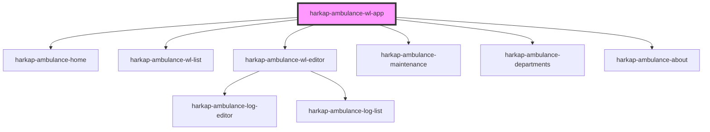

# harkap-ambulance-wl-app

<!-- Auto Generated Below -->

## Properties

| Property   | Attribute   | Description | Type     | Default     |
| ---------- | ----------- | ----------- | -------- | ----------- |
| `apiBase`  | `api-base`  |             | `string` | `undefined` |
| `basePath` | `base-path` |             | `string` | `''`        |

## Dependencies

### Depends on

- [harkap-ambulance-home](../harkap-ambulance-home)
- [harkap-ambulance-wl-list](../harkap-ambulance-wl-list)
- [harkap-ambulance-wl-editor](../harkap-ambulance-wl-editor)
- [harkap-ambulance-maintenance](../harkap-ambulance-maintenance)
- [harkap-ambulance-departments](../harkap-ambulance-departments)
- [harkap-ambulance-about](../harkap-ambulance-about)

### Graph

----------------------------------------------

*Built with [StencilJS](https://stenciljs.com/)*
